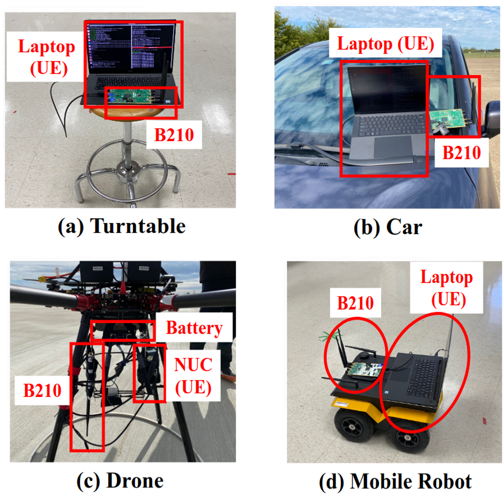

.. meta::
   :description: EdgeRIC channel traces, collected over a range of UE mobility scenarios. Use them to drive repeatable 5G experiments in emulation.

EdgeRIC Main Dataset
===============

We collect a variety of Channel Traces over a wide range of UE mobility scenarios.  
  
The trace files can be found here: `Traces <https://github.com/ushasigh/EdgeRIC-A-real-time-RIC/tree/main/srsRAN-4G-new-ER-design/srsRAN_4G-ER-ue1/cqis>`_