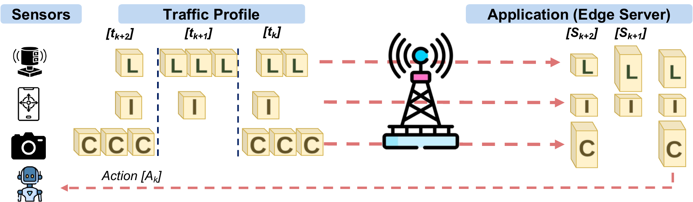
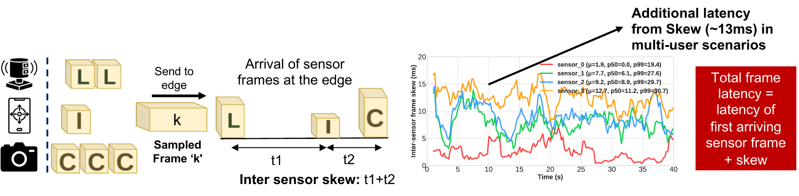
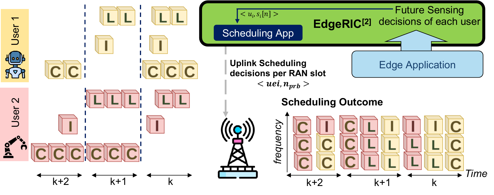
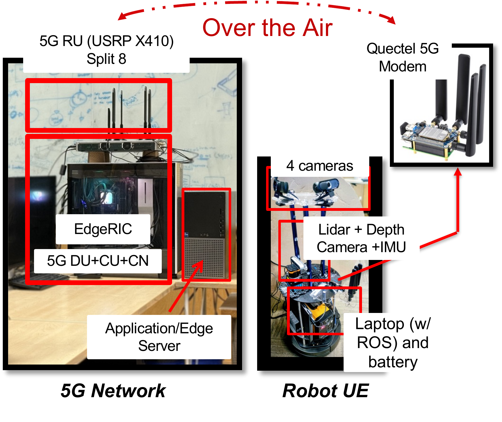
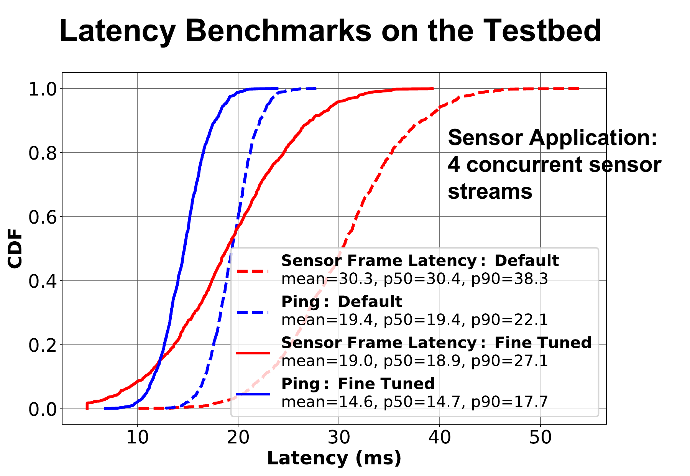
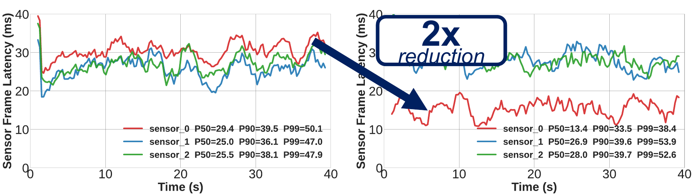

.. meta::
   :description: mmsRAN schedules the cellular uplink so a robot's LiDAR, camera, and inertial streams reach the edge together, in time for each step of its control loop.

mmsRAN: Multimodal Cellular Uplink for Physical AI
======================================================

mmsRAN investigates how cellular uplink scheduling can deliver a robot's multimodal sensor
streams together, in time for each step of its control loop. The goal is to synchronize
sensor-frame delivery within a user and across users so that an edge application can act on
relevant observations.

**Team:** `Ushasi Ghosh <https://ushasigh.github.io/>`_, `Sreevatsank Kadaveru <https://sreevatsankk.github.io/>`_, Srinivas Shakkottai, and Dinesh Bharadia.

**More details:** `mmsRAN project page <https://sreevatsankk.github.io/research/mmsran/>`_

Why Physical AI Needs Synchronized Uplink
---------------------------------------------

A robot sends multiple sensor streams, such as LiDAR, camera, and inertial measurements, to an
application at the edge. This creates uplink-heavy traffic. The feedback control loop operates
in discrete timesteps, and all sensor streams for a timestep must arrive within that timestep
to remain relevant to the next action.

         application, which combines the observations and returns an action to the robot.

   Multimodal sensing and the feedback control loop. Different sensors generate different
   amounts of traffic for each timestep.

The Challenge: Access Latency and Frame Misalignment
--------------------------------------------------------

Cellular uplink access latency includes both **protocol overheads** and **scheduling delays**.
For multimodal applications, the arrival time of the complete observation also matters:

* **Inter-sensor skew:** streams from the same user arrive at different times. The application
  waits for the last required sensor frame before it has a complete observation.
* **Inter-user frame misalignment:** a user with a good channel can deliver newer frames while
  another user's earlier frame is still incomplete.

The complete frame's latency is the first sensor frame's arrival latency plus the skew to the
last required sensor frame. Our multi-user measurements show approximately **13 ms
of additional latency from skew**.

         shows inter-sensor skew and approximately 13 milliseconds of additional latency
         in a multi-user scenario.

   Delivering one sensor stream early does not complete the multimodal observation. The
   remaining streams determine when the application can use the full frame.

Design: Multimodal Flow Synchronization
-------------------------------------------

mmsRAN explores **coflow-inspired scheduling**: treating the sensor streams needed for a
control timestep as a group whose completion matters to the application. The research goal
is to synchronize these streams for real-time robotic control.

         future sensing decisions to an EdgeRIC scheduling app, which assigns uplink
         resources to users on each RAN slot to coordinate frame delivery.

   Proposed scheduling loop. The edge application provides information about future sensing
   decisions, and the EdgeRIC app makes uplink resource-allocation decisions per RAN slot.

The design combines two mechanisms:

* **Pre-emptive user scheduling:** proactively allocate uplink resources to reduce the latency
  of acquiring a grant.
* **Application-aware data radio bearers (DRBs):** use per-modality quality-of-service (QoS)
  flows to enable independent queueing and prioritization at the user equipment (UE).

Network Testbed
-------------------

The over-the-air 5G testbed connects a robot UE to an application server at the edge:

* **5G network:** a USRP X410 radio unit using Split 8, with the distributed unit (DU), central
  unit (CU), core network (CN), and EdgeRIC on the network side.
* **Robot UE:** a Quectel 5G modem, four cameras, LiDAR, a depth camera, and an inertial
  measurement unit (IMU), with a laptop running ROS and a battery.
* **Access configuration:** fine-tuned 5G settings and scheduling-request-free (SR-free)
  access to reduce latency.

         alongside the robot UE with cameras, LiDAR, a depth camera, an IMU, a ROS laptop,
         and a Quectel 5G modem.

   Network and robot hardware used in the over-the-air testbed.

Preliminary Results
-----------------------

Network Configuration
^^^^^^^^^^^^^^^^^^^^^^^^^

With **four concurrent sensor streams**, fine-tuning the network configuration reduces median
sensor-frame latency from **30.4 ms to 18.9 ms**. Ping is a separate network benchmark from
sensor-frame delivery.

         configurations. Median sensor-frame latency falls from 30.4 to 18.9 milliseconds,
         and median ping falls from 19.4 to 14.7 milliseconds.

   Latency distributions for the default and fine-tuned network configurations.

Prioritization Across Sensor Streams
^^^^^^^^^^^^^^^^^^^^^^^^^^^^^^^^^^^^^^^^

In a separate experiment with three sensor streams, **DRB-based prioritization** reduces the
high-priority stream's median sensor-frame latency from **29.4 ms to 13.4 ms**, approximately
a **2× reduction**, without starving the other flows. Their median latencies change from
25.0 to 26.9 ms and from 25.5 to 28.0 ms, respectively.

         sensor 0's median latency drops from 29.4 to 13.4 milliseconds, while the other
         streams continue to receive service with medians of 26.9 and 28.0 milliseconds.

   Per-stream latency before (left) and with (right) DRB-based prioritization.

These measurements demonstrate network tuning and per-stream prioritization. Synchronizing
complete multimodal observations across users remains the broader research goal.

Publication
---------------

**WiP: mmsRAN: Multimodal Cellular Uplink for Physical AI**

`Publication DOI: 10.1145/3795866.3844782 <https://doi.org/10.1145/3795866.3844782>`_

Acknowledgement
-------------------

This work was recognized for the **Qualcomm Innovation Fellowship 2026**.
