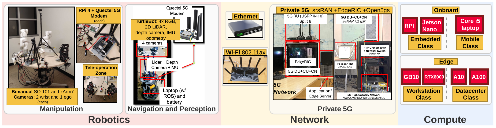
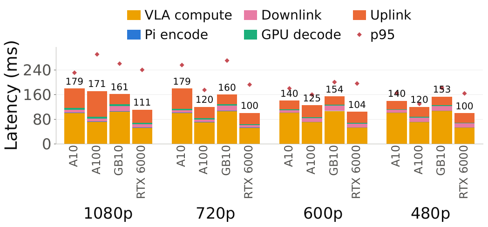
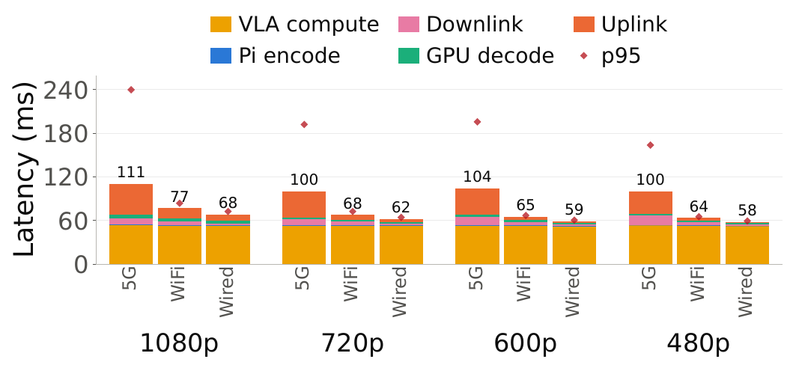

RoboNEST: Edge Driven Robotics
==================================

RoboNEST, the **Robotics Networked Edge Systems Testbed for Physical AI**, brings real robots,
wireless networks, and edge compute into one experimental platform. It supports closed-loop
perception, planning, and vision-language-action (VLA) inference, with visibility into the
complete path from sensing to action.

**Team:** Sreevatsank Kadaveru, Ushasi Ghosh, and Dinesh Bharadia, UC San Diego.

Why an End-to-End Testbed?
------------------------------

Offloading robotic workloads to an edge server puts network transport and GPU inference
directly in the control loop. Network capacity, scheduling, and compute availability can all
affect when a robot receives its next action.

RoboNEST makes these interactions observable in real tasks. Researchers can change the access
network or compute platform and correlate application events with network, modem, GPU, and
robot telemetry.

Testbed Design
------------------

         Ethernet, Wi-Fi, and private 5G access, plus onboard and edge compute options.

   The RoboNEST platform connects robotics, interchangeable access networks, and compute.

Robotics and Multimodal Streaming
^^^^^^^^^^^^^^^^^^^^^^^^^^^^^^^^^^^^^

* **Manipulation:** two xArm7 7-DoF arms and two SO-101 leader-follower pairs, with wrist and
  ego cameras and joint and gripper telemetry. Tasks include pick-and-place, cube stacking,
  sorting, object passing, and cloth folding. Arms can operate individually or together.
* **Navigation and perception:** a TurtleBot with four RGB cameras, a 2D LiDAR, an Intel
  RealSense depth camera, an IMU, and odometry supports collision avoidance, mapping, and SLAM.
* **Teleoperation:** Meta Quest 3 VR and physical leader-follower control for SO-101 support
  human-operated experiments alongside policy-driven execution.

Each platform uses a Raspberry Pi, Jetson, or laptop to interface with sensors and actuators.
It encodes sensor observations, streams them to the edge, and executes the returned actions.

Interchangeable Access Networks
^^^^^^^^^^^^^^^^^^^^^^^^^^^^^^^^^^^

Robots can connect to the edge through three access technologies:

* **Ethernet:** switched 1 GbE provides a low-latency reference for isolating compute effects.
* **Wi-Fi:** an 802.11ax access point uses a dedicated 5 GHz SSID and 40 MHz bandwidth.
* **Private 5G:** Quectel RM500, RM502, RM520, and RM530 modems connect to a gNB operating in
  band n78 with 40 MHz bandwidth and an Open5GS core. EdgeRIC exposes RAN state and enables
  network control at TTI/slot granularity.

Edge Compute
^^^^^^^^^^^^^^^^

The edge infrastructure spans six GPU hosts with 12 A10 GPUs, two A100 GPUs with 40 GB each,
a GB10 with 128 GB, and two RTX 6000 GPUs. Containerized services share available accelerators.
The 5G RAN, core, and EdgeRIC are co-located with this infrastructure, enabling joint control
of network and compute resources.

Multi-User Experiments and Observability
--------------------------------------------

RoboNEST can connect four robotic-arm UEs and one mobile TurtleBot UE concurrently, alongside
Pixel 9 UEs generating background enhanced mobile broadband (eMBB) traffic.

Hosts synchronize clocks using NTP through chrony, achieving approximately **200 microseconds
of synchronization accuracy** for aligning timestamps across nodes. Automated logging
correlates application events with RAN state, modem diagnostics, GPU inference, and robot
execution. The Qualcomm Unified Tools Service (QUTS) API streams per-UE modem logs over USB/IP
to server-side QXDM for diagnosis.

Achieving Real-Time Operation
---------------------------------

The platform reduces overhead throughout the sensing-to-action pipeline:

* **VLA inference:** model quantization, execution compilation, CUDA graph optimizations,
  and CPU/GPU clock pinning reduce inference latency.
* **Sensor processing:** camera-native hardware encoding and GPU decoding avoid intermediate
  transcoding, while efficient CPU-GPU memory transfers reduce processing overhead.
* **Network transport:** the 5G stack is configured for uplink-heavy traffic and low latency.

Glass-to-Action Latency
---------------------------

The evaluation runs an **SO-101 closed-loop manipulation task** with the :math:`\pi_{0.5}` VLA policy at
1080p, 720p, 600p, and 480p. Synchronized timestamps separate VLA compute, Pi encoding, GPU
decoding, uplink, and downlink contributions to end-to-end latency.

Compute Comparison over 5G
^^^^^^^^^^^^^^^^^^^^^^^^^^^^^^

With the network fixed to 5G, the 1080p task has **111 ms** glass-to-action latency on an
RTX 6000, compared with **179 ms** on an A10, a **38% reduction**. The comparison also includes
A100 and GB10 platforms.

         at four image resolutions. At 1080p, latency is 179, 171, 161, and 111 milliseconds,
         respectively. Diamond markers show p95 latency.

   Compute comparison with the access network fixed to 5G. Bars show the latency breakdown,
   and diamond markers indicate p95.

Network Comparison on RTX 6000
^^^^^^^^^^^^^^^^^^^^^^^^^^^^^^^^^^

With compute fixed to an RTX 6000, glass-to-action latency at **1080p** is **111 ms over 5G,
77 ms over Wi-Fi, and 68 ms over Ethernet**. At **480p**, these values fall to **100 ms,
64 ms, and 58 ms**, respectively.

Higher image resolution primarily increases the uplink contribution, while VLA compute
remains nearly constant. Larger encoded frames require more bytes to cross the uplink and
can add queueing delay as offered load approaches available capacity.

         image resolutions. At 1080p the totals are 111, 77, and 68 milliseconds. At 480p
         they are 100, 64, and 58 milliseconds. Diamond markers show p95 latency.

   Network comparison with compute fixed to an RTX 6000. The measurements cover the full
   sensing-to-action path, including compute and sensor processing.

MobiCom 2026 Demonstration
------------------------------

The planned demonstration uses a remotely operated SO-101 manipulation setup over private 5G
in two modes:

* **Teleoperated pick-and-place:** an operator at the remote testbed controls the robot while
  attendees watch a live video stream over 5G.
* **Autonomous pick-and-place:** a VLA policy hosted at the edge generates the robot's actions.

Experiments will be launched and controlled live from laptops. A dashboard will display
end-to-end latency and network throughput during task execution.

Publication
---------------

**Demo: RoboNEST: Robotics Networked Edge Systems Testbed for Physical AI**

`Demo@MobiCom'26 <https://doi.org/10.1145/3795866.3848480>`_
